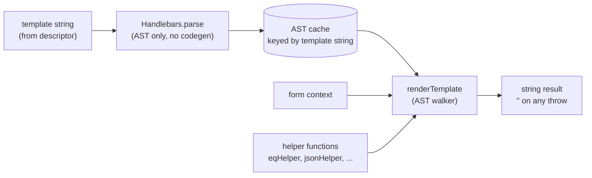
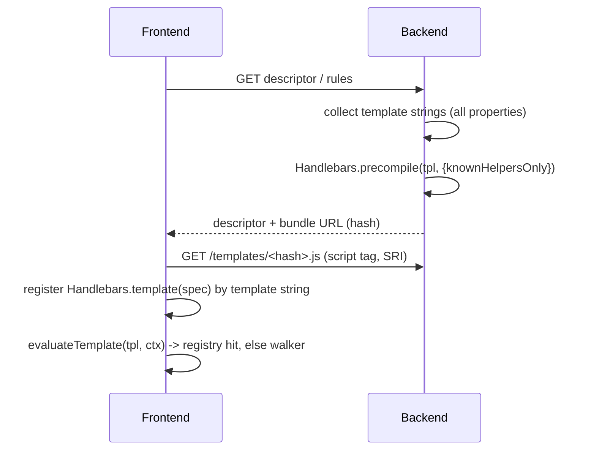

# CSP-safe template runtime: why an AST walker, why not precompile

| | |
|---|---|
| **Date** | 2026-11-02 |
| **Branch reviewed** | `cursor/csp-safe-template-runtime` (tip `7a8a82b`, 3 commits on top of `1d80989`) |
| **Related branch** | `feat/use-handlebars-ast-walker-package` (`de712f1`), same idea, extracted into a package |
| **Status of this document** | Review and decision report. No application code was changed. |

---

## 1. Summary

**The problem.** Integration hosts serve the form under `Content-Security-Policy: script-src * 'unsafe-inline'`. That policy forbids `eval` and `new Function`. `Handlebars.compile` builds a JavaScript function from every template string with `new Function`, so every descriptor template (hidden, disabled, readonly, defaults, URLs, payloads, item templates) threw `EvalError` in the browser.

**What the branch did.** It stopped compiling. `Handlebars.parse` (which only builds an AST) feeds a new interpreter, `src/utils/template-runtime.ts`, that walks the AST and calls the existing helper functions directly. No JavaScript is ever generated. It is an *interpreter*, not a compiler. `evaluateTemplate` stayed the single public entry point, and the template language for descriptor authors did not change.

**Why precompiling was excluded.** The branch documents three reasons:

1. Templates arrive at runtime inside backend-authored descriptors and rules, so they cannot be known at build time.
2. Precompiling on the server and shipping the generated source back still needs `new Function` in the browser, and turns backend text into executable JavaScript.
3. Evaluating on the server only would break the client fast loop (under 100 ms).

I tested these claims. Reasons 1 and 3 hold. Reason 2 is **true for the "send source as JSON and eval it" variant, but not for the "load it as a script" variant**. Under the exact integration policy, a dynamically created `<script>` (inline or same-origin `src`) runs fine. Precompile was therefore not technically impossible. It is the wrong trade-off here, mainly because it makes the descriptor a code-delivery channel and does not remove the client-side string rewriting that this engine depends on (section 8).

**Security of the AST walker.** The approach is a net security gain: it removes the whole class of "template becomes code" bugs (the historical Handlebars RCE advisories). It is not free of problems. I verified these on the branch:

| # | Finding | Severity |
|---|---|---|
| S1 | Path lookup has no own-property check. Inherited properties resolve (`{{lookup a "constructor"}}` prints `function Object() { [native code] }`). Real Handlebars denies this since 4.6.0. | Low–Medium |
| S2 | The helper table is a plain object literal. Inherited names are callable as helpers (`{{constructor}}`, `{{toString}}`, `{{hasOwnProperty "x"}}`, `{{__defineGetter__ …}}`). One template can **permanently break a helper** (`{{eq 1 1}}` returned `''` afterwards). | Medium |
| S3 | Any unsupported syntax throws, and `evaluateTemplate` converts that to `''`. For `hidden`/`disabled`/`readonly`, `''` means "not hidden / not disabled". Failure shows fields rather than hiding them. | Medium (design) |
| S4 | The error path logs the whole context (`formData`, `caseContext`: KYC PII) to the console. Pre-existing, but the walker throws more often. | Medium |
| S5 | Unbounded `each`, recursion and parse cache. | Low |

**Correctness regressions found.** One unit test fails on the branch and passes on `main`: a new global helper named `item` shadows the context variable `item`, so `{{item}}` renders `[object Object]`. There are also parity gaps with real Handlebars (`@root` outside `each`, `each` over objects, `with`, hash args, string `.length`).

**Can precompile still be done?** Yes, as an optional second tier (section 9). It would be a multi-week change with a server codegen pipeline, a script-delivery channel, handling for `@index` string rewriting, and Handlebars version coupling between backend and every integration host.

**Recommendation.** Keep the AST walker. Harden it (small, about 1–2 days). Add a differential test suite that runs a template corpus through both real Handlebars and the walker. Revisit precompile only if one of the triggers in section 10 happens.

---

## 2. Context

### 2.1 Why the engine is dynamic

`vision.md` makes the form engine metadata-driven: a regulatory change is a descriptor or rules change, not a frontend deploy. Hybrid reactivity is a non-negotiable. Inline validation and hidden/disabled/readonly evaluation must run on the client in under 100 ms, with no round trip. Re-hydration from the backend is allowed under 500 ms (p95). Backend stays authoritative for validation and compliance.

Descriptors and rules (and therefore the templates inside them) are fetched at runtime, per case and per jurisdiction.

### 2.2 The CSP failure

```
Error evaluating template: EvalError: Evaluating a string as JavaScript violates the following
Content Security Policy directive because 'unsafe-eval' is not an allowed source of script:
script-src * 'unsafe-inline'
```

Two call sites compiled templates:

| Site | Use |
|---|---|
| `getCompiledTemplate` in `src/utils/template-evaluator.ts` | Every status, default, URL, payload and validation template |
| `extractArray` and `transformItem` in `src/utils/response-transformer.ts` | `iteratorTemplate` and `itemsTemplate` for data sources |

### 2.3 Where templates come from (this decides what is possible)

Template strings live in many descriptor properties (`src/types/form-descriptor.ts`): `status.hidden/disabled/readonly`, `defaultValue`, `url`, `payloadTemplate`, `itemsTemplate`, `iteratorTemplate`, `valueTemplate`, `repeatableSummaryTemplate`, `repeatableDefaultSource`, validation and options templates, and key segments.

Some template strings are also **rewritten on the client before evaluation**:

| Rewrite | Location |
|---|---|
| `@outerIndex` then `@index` replaced by the row number, e.g. `{{caseContext.items.@index.name}}` becomes `{{caseContext.items.0.name}}` | `src/utils/default-value-evaluator.ts` |
| Same binding inside popin and repeatable seeding | `src/utils/form-descriptor-integration.ts` |
| `@index/@first/@last` replaced by `index/first/last` context variables | `src/components/repeatable-field-group.tsx` |

The template set is therefore open-ended and partly derived in the browser. The syntax actually used in the repo's demo descriptors is small: `{{#if}}`, `{{else}}`, `{{#unless}}`, one `{{#each}}`, and helper calls (`not`, `eq`, `item`, `json`, `isEmpty`, …).

---

## 3. What the branch changed



| Area | Change |
|---|---|
| `src/utils/template-runtime.ts` (new, about 370 lines) | Walker: `ContentStatement`, `CommentStatement`, `MustacheStatement`, and blocks `if`, `unless`, `each`. Expressions: paths (`../`, `@first/@last/@index/@key/@root`), literals, sub-expressions. Throws on hash args and unknown nodes. Reproduces Handlebars HTML escaping, `~` whitespace control, and `#if` emptiness rules. |
| `src/utils/template-evaluator.ts` | `Handlebars.compile` replaced by `Handlebars.parse` plus `renderTemplate`. Cache holds ASTs. |
| `src/utils/response-transformer.ts` | Both former compile sites go through `evaluateTemplate`. |
| `src/utils/handlebars-helpers.ts` | Helper logic extracted into plain exported functions (`eqHelper`, `jsonHelper`, …). Adds `SafeHtml` (brand via module-private `Symbol`) and new helpers `item`, `itemIf`, `radioGroup`, `withChildren`, `jsonItems`, `containsAny`. `registerHandlebarsHelpers` kept for tests. |
| Tests | `template-runtime.test.ts` (about 320 lines), updates to helper/evaluator tests, a Playwright test `e2e/csp-template-eval.spec.ts` that serves `/demo` under the integration CSP and asserts `new Function` is still blocked. |
| Docs | `docs/csp-safe-template-evaluation.md`, `docs/template-runtime.md`. |
| Unrelated changes bundled in | Next 16 `params: Promise<…>` fixes in two route handlers, `next.config.ts` `ignoreBuildErrors` behind `CSP_E2E_BUILD=1`, deletion of `test-results/` artefacts, `e2e/**` excluded from Vitest. |

**State of the branch.** It merges into current `main` without conflicts (`git merge-tree`). `main` has moved on (nested blocks, `@outerIndex`), so a re-test after merge is needed. On the branch, `src/utils` tests give 460 pass and **1 fail** (section 7). I did not run the Playwright test, which needs a full production build.

**Sibling branch.** `feat/use-handlebars-ast-walker-package` replaces the in-repo walker with a published package, `handlebars-ast-walker@0.1.0` (single maintainer), plus `@handlebars/parser`, and drops the `handlebars` dependency. Same architecture, different ownership of the interpreter. I did not audit that package's source.

---

## 4. Why precompiling was excluded

### 4.1 What "precompile" means

Handlebars' own CSP guidance is: precompile at build time and ship only the small runtime. `Handlebars.precompile(tpl)` returns JavaScript **source text** for a spec object (`{"compiler":[8,">= 4.3.0"],"main":function(container,depth0,helpers,…){…}}`). The runtime wraps it with `Handlebars.template(spec)`. The runtime never calls `new Function`. The generated source has to enter the page as a real script, not as a string that is evaluated.

I confirmed this with Node's `--disallow-code-generation-from-strings`:

| Operation | Result |
|---|---|
| `Handlebars.compile('{{a}}')` | blocked |
| `eval('(' + precompiledSpecString + ')')` | blocked |
| Precompiled spec loaded as a normal module, run with the runtime-only build | works (`US` gives `false`, empty gives `true`) |

### 4.2 The three documented reasons, assessed

| # | Reason (from `docs/csp-safe-template-evaluation.md`) | Assessment |
|---|---|---|
| 1 | Templates arrive at runtime in descriptors, rules, defaults, URLs, payloads and `itemsTemplate`. A new jurisdiction rule is a descriptor change, not a deploy. | **Holds.** Build-time precompile cannot cover this. The engine would need a server-side precompile step on the hot path (section 8). |
| 2 | Precompiling on the server and sending the source back still needs `new Function` in the browser, and makes backend text executable JavaScript. | **Half true.** Sending source as data and evaluating it is blocked (verified). Delivering it as a `<script>` is not blocked under `script-src * 'unsafe-inline'`. The second half (backend text becomes executable code) is a real and strong reason. |
| 3 | Server-only evaluation removes `new Function` from the page but kills the fast loop. | **Holds.** It contradicts a vision non-negotiable (under 100 ms, no round trip for hidden/disabled/readonly). |

### 4.3 Measured: what the integration CSP does and does not block

I ran Chromium (Playwright) against a local server that sets the integration policy `script-src * 'unsafe-inline'`, and tried each delivery mechanism for a precompiled spec:

| Mechanism | Result under `script-src * 'unsafe-inline'` |
|---|---|
| `new Function('return 1')()` | **blocked** |
| `eval('(' + spec + ')')` (spec delivered as JSON) | **blocked** |
| Dynamically created `<script>` with `textContent` (inline) | **allowed** |
| Dynamically created `<script src="/tpl.js">` (same origin) | **allowed** |
| `<script src="blob:…">` | **blocked** (`*` does not cover `blob:`) |

So the doc's statement is accurate for *string evaluation* but too broad as a statement about all precompile delivery. This matters for the decision in section 10. It also shows how loose the host's policy is: `*` plus `'unsafe-inline'` means any script from any host, plus inline script, is allowed. Anything that lets descriptor content reach a script element would be a full XSS in a KYC application.

### 4.4 The real reasons precompile is a poor fit

Ranked by weight:

1. **Descriptor content becomes code.** With the walker, a hostile or buggy template can at worst change what the UI shows. With precompile, a template string is fed to a code generator on the server and the output is run in the user's origin. Historical Handlebars advisories (for example the prototype-pollution and compile-time RCE issues fixed in 4.x) are the class of bug this reintroduces on the server and the client.
2. **Client-side template derivation.** The `@index`/`@outerIndex` text substitution produces new template strings per row in the browser. A server cannot precompile strings that do not exist yet unless the substitution is redesigned (section 8).
3. **Asynchronous delivery against a synchronous engine.** `evaluateTemplate` is synchronous and used in render. Precompiled templates must have been downloaded and registered first. Every re-hydration that introduces new template text adds a script load inside the 500 ms slow-loop budget.
4. **Version coupling.** Precompiled specs embed a compiler revision (`"compiler":[8,">= 4.3.0"]`). The runtime checks it. The backend that precompiles and the frontend bundle embedded in each integration host must stay compatible. The walker only needs the parse AST format.
5. **Policy dependency.** It works today because the host allows `'unsafe-inline'` or `*`. A host that moves to nonce-based or `strict-dynamic` CSP would break injected scripts again. The walker is independent of CSP.

---

## 5. Impact of the chosen approach

### 5.1 What improved

| Aspect | Result |
|---|---|
| CSP | Evaluation works with no `unsafe-eval`. Verified in the walker tests and by the e2e design. |
| Template language | Unchanged for authors. |
| Late-arriving templates | Supported, since nothing is built ahead of time. |
| Fast loop | Faster than before (see below). |
| Attack surface | No code generation in the browser. |

Measured on the branch (Vitest, single machine, 100,000 warm iterations, 1,000 cold templates; indicative only):

| Template | Compiled, per call | Walker, per call | Cold compile, per template | Cold parse + walk, per template |
|---|---|---|---|---|
| `{{not (or (eq country "US") (eq country "CA"))}}` | 3.6 µs | 0.37 µs | 123 µs | 26 µs |
| `{{#if (eq country "US")}}…{{else}}[]{{/if}}` | 3.7 µs | 0.16 µs | 85 µs | 18 µs |
| `{"label":"{{item.name}}","value":"{{item.code}}"}` | 2.9 µs | 0.28 µs | 55 µs | 11 µs |

Performance is not a concern for the 100 ms budget.

### 5.2 What it costs

| Cost | Detail |
|---|---|
| **Owning an interpreter** | About 370 lines that must match Handlebars semantics where the descriptor relies on them. Every divergence is a silent behaviour change. |
| **Unsupported syntax fails quietly** | Hash arguments, `with`, partials, block params, `each` over objects, `@root` outside `each`, and more are not implemented (section 7). |
| **Fail-open status results** | See S3. |
| **Bundle** | The browser still ships the **full** Handlebars (about 88 KB minified, 27 KB gzip) to use `parse`. The runtime-only build is about 29 KB minified, 10 KB gzip. `@handlebars/parser` alone is a smaller alternative (the sibling branch uses it). |
| **Helper duplication risk** | Helpers now exist in two forms: exported functions and `Handlebars.registerHelper` wrappers kept for tests. Two routes to the same function can drift. |

---

## 6. Security review of the AST walker

### 6.1 What is better than before

- **No code generation.** The walker never builds source text, so none of the template-to-code injection bugs apply.
- **Output escaping matches Handlebars.** `escapeHtml` uses the same character map. `{{{raw}}}` is honoured.
- **`SafeHtml` cannot be forged from data.** It is identified by a module-private `Symbol` with an `in` check. JSON from the backend or a user cannot carry that symbol.
- **No `Function`, `eval` or `innerHTML`** in `src/utils` on the branch (checked with grep; the only `new Function` is the probe in the e2e test).
- **Helpers are called only with evaluated values.** There is no path that invokes a function taken from the context.

### 6.2 Findings

All findings below were reproduced by running the branch code in Vitest. The attacker model is "someone who can influence template text" (compromised backend, malicious rules author) or "someone who can pollute `Object.prototype`". User-entered form data cannot change template text, so ordinary applicants cannot reach these.

**S1. No own-property check on lookup (Low–Medium).**
`lookupPath` and the `lookup` helper read `current[part]` directly. Real Handlebars (since 4.6.0, the fix for CVE-2019-19919) only resolves own properties unless explicitly allowed.

| Template | Real Handlebars | Walker |
|---|---|---|
| `{{lookup a "constructor"}}` (`a = {}`) | `` | `function Object() { [native code] }` |
| `{{a.toString}}` | `` | `function toString() { [native code] }` |
| `{{a.b}}` where `b` is only on the prototype | `` | `inherited` |

Impact: information disclosure of prototype members. No execution, because nothing in the walker calls a looked-up function. It can become a stepping stone for S2 (it supplies function values to helper arguments).

**S2. Inherited names resolve as helpers (Medium).**
`helpers` is a plain object literal, and `renderMustache` does `if (name && helpers[name])`. Names such as `constructor`, `toString`, `valueOf`, `hasOwnProperty`, `__defineGetter__` are therefore treated as helpers, called with `this === helpers`.

- `{{constructor}}`, `{{toString}}`, `{{valueOf}}` render `[object Object]`. Real Handlebars renders empty.
- `{{hasOwnProperty "x"}}` renders `false`. Real Handlebars throws "Missing helper".
- **State tampering:** after evaluating `{{__defineGetter__ "eq" (lookup (lookup this "x") "constructor")}}` with context `{ x: {} }`, the next `{{eq 1 1}}` returned `''` and logged `TypeError: helpers[name] is not a function`. The module-level helper table stays corrupted for the life of the page. Every `eq`-based hidden rule then fails open (S3).
- A related effect without any attacker template: if any other library sets a property on `Object.prototype`, then `{{thatName}}` throws `helpers[name] is not a function` (reproduced with `Object.prototype.polluted = 'YES'`).

Fix: build `helpers` with `Object.create(null)` or use a `Map`, and test names with `Object.hasOwn`.

**S3. Fail-open on any failure (Medium, design).**
`evaluateTemplate` returns `''` on any exception. `parseBooleanResult('')` is `false`. So an unsupported construct, a tampered helper or a missing helper yields "visible" and "enabled". Backend re-validation still protects data (vision principle), and showing extra fields is safer than hiding required ones. It still gives users a confusing form and can expose fields that a rule meant to hide (for example fields for a different jurisdiction). Consider a per-property policy (for example hidden defaults to the safe-visible value, readonly and disabled may need the opposite), surfaced as a telemetry event rather than a console line.

**S4. Context logged on failure (Medium).**
```
console.error('Error evaluating template:', error, 'Template:', template, 'Context:', context);
```
`context` includes `formData` and `caseContext`, which hold KYC personal data. This exists on `main` too, but unsupported syntax in the walker now raises this log far more often, and hosts may collect console output. Log the template and error only, or redact.

**S5. Resource limits (Low).**
- No cap on template length, nesting depth or `each` length. Recursion depth follows template nesting. The parser is the same as before, so this is not new.
- The parse cache is an unbounded `Map` keyed by template string. Templates that embed per-row values (the `@index` rewrite) or ids grow it over a long session. Add an LRU bound.

**S6. Unchanged risks to keep in mind.**
- `{{json}}` returns unescaped JSON containing user strings. It is safe while the result is `JSON.parse`d. It would be an XSS sink if anyone put it into HTML.
- JSON assembled from templates (`{"label":"{{item.name}}"}`) is vulnerable to a value containing `\`, because Handlebars escaping does not escape backslashes. Same as before the branch.
- The sibling branch adds a third-party 0.1.0 package as the evaluation core. It needs a supply-chain and code review before it replaces in-repo code.

---

## 7. Correctness and parity findings

Run against real `Handlebars.compile` as the oracle (helpers registered):

| Template | Real Handlebars | Walker | Used in repo today? |
|---|---|---|---|
| `{{item}}` with context `{item: 'simple string'}` | `simple string` | `[object Object]` | `response-transformer.test.ts` (the one failing test) |
| `{{@root.x}}` outside `each` | value | `` | not seen |
| `{{#each obj}}{{@key}}={{this}};{{/each}}` over an object | `a=1;b=2;` | `` | not seen |
| `{{#with a}}{{b}}{{/with}}` | `w` | throws, returns `` | not seen |
| `{{foo a=1}}` (hash args) | handled | throws, returns `` | not seen |
| `{{a.length}}` with `a = 'abc'` | `3` | `` | not seen |
| `{{#if a}}…{{else if b}}…{{/if}}` | `b` | `b` | ok |
| `{{#each items}}{{../prefix}}{{this}}{{/each}}`, `{{{raw}}}`, `{{json …}}`, `{{lookup this "x"}}` | match | match | ok |

**The `item` regression.** The branch registers a global helper called `item` (`{label, value}` builder). Bare `{{item}}` now finds a helper first. `itemsTemplate` evaluation puts the API row in a context variable also called `item` (`transformItem`), so any template that uses `{{item}}` without a property path breaks. `{{item.name}}` still works (a two-part path is a lookup, not a helper call). Real Handlebars has the same helper-first rule for bare names, so this is a naming collision, not walker-specific. It breaks an existing unit test on the branch (it passes on `main`: 18/18 in `response-transformer.test.ts`). Rename the helper (for example `listItem`) or change the resolution order and test both.

---

## 8. Can precompiling actually be done here?

Yes technically. It is expensive because of how this engine builds and uses templates.

### 8.1 What makes it hard

| Obstacle | Why |
|---|---|
| Template set is open-ended | Defined by backend descriptors and rules per case and jurisdiction. The precompile step must run wherever descriptors are produced or on the fly. |
| Client-derived templates | `@index`/`@outerIndex` text substitution (section 2.3) creates strings that do not exist server-side. |
| Many template-bearing properties | Roughly ten descriptor properties (section 2.3) plus nested structures (sub-forms, popins, repeatables). The collector must walk all of them and stay in sync as types change. |
| Synchronous consumer | `evaluateTemplate` is sync and called in render. The registry must be filled before first render and after every re-hydration. |
| Custom helpers | The precompiled code looks up helpers by name at run time. Frontend must register the same pure helper functions on a runtime-only Handlebars instance. Compile with `knownHelpersOnly` so unknown helpers fail at build time. |
| Version skew | Backend Handlebars compiler revision must be accepted by every embedded frontend runtime. |
| Nesting of strings | Several templates are strings inside JSON inside descriptors, evaluated after other substitutions. Order matters. |

### 8.2 Design if it were implemented ("hybrid, tier 2")



Steps:

1. **Collect templates.** A shared function walks a descriptor and returns the set of template strings per property (including expanded `@index`/`@outerIndex` forms; see step 3).
2. **Precompile on the server.** `Handlebars.precompile(tpl, { knownHelpersOnly: true, knownHelpers: { eq: true, … } })` for each string. Treat templates as code: size limits, an allow-listed helper set, Handlebars pinned to a patched version, input from trusted authors only.
3. **Make template strings stable.** Replace textual `@index` substitution by a context variable and an AST rewrite at collection time. For example `{{caseContext.items.@index.name}}` becomes `{{lookup (lookup caseContext.items index) "name"}}`, with `index`/`outerIndex` supplied in the context. The repeatable summary code already does a variant of this (`@index` becomes `index`). Without this step, the registry would need one spec per row number.
4. **Deliver as script, not data.** Serve `/api/form/templates/<hash>.js`, content-type `text/javascript`, immutable cache, with `integrity`. Writing `(registry[tplString] = Handlebars.template({...}))` lines. Loaded by a script element (allowed under the integration policy, section 4.3). Do not deliver as JSON and do not evaluate it.
5. **Client registry.** `evaluateTemplate` checks the registry first (keyed by template string or a stable hash), then falls back to the walker, then to `''`.
6. **Runtime.** Ship `handlebars/runtime` (about 10 KB gzip) in place of full Handlebars, with the same helper functions registered. This also gives real Handlebars semantics (own-property checks, hash args, `with`, partials), removing the parity gap in section 7.
7. **Tests.** Differential tests, an e2e under the integration CSP and, if hosts differ, a stricter policy.

### 8.3 Effort and risk (rough, qualitative)

| Piece | Size |
|---|---|
| Template collector and descriptor walk | medium (many properties, nested structures) |
| `@index` rewrite to stable templates | medium–high (touches `default-value-evaluator`, `form-descriptor-integration`, `repeatable-field-group`, `block`) |
| Server precompile and bundle endpoint | medium |
| Frontend registry, async preload, loading states, errors | medium |
| Version-compatibility handling across hosts | ongoing |
| Security review of the codegen path | required |
| **Total** | **several weeks** versus **1–2 days** to harden the walker |

### 8.4 Build-time-only precompile

Only works if the template set is closed, for example descriptors reference named templates (`templateId`) shipped with the frontend. That removes the "new jurisdiction without deploy" property, so it conflicts with `vision.md`.

### 8.5 Other options considered

| Option | Verdict |
|---|---|
| Server-side evaluation only | Breaks the fast loop. Rejected (section 4.2). |
| Sandboxed iframe or Worker with `eval` | Inherits the page policy by default. Needs host cooperation. Rejected. |
| WebAssembly | Compiling needs `'wasm-unsafe-eval'`. Rejected. |
| Different expression language (JsonLogic and similar) | CSP-safe by design and declarative, but changes the descriptor contract. The repo already has a `tasks/jsonlogic-integration-epic.md`. A larger migration, not a CSP fix. |
| Third-party walker package (sibling branch) | Same design, shifts ownership. Needs audit. |

---

## 9. Is precompile still a viable solution?

Yes, as an add-on and not as a replacement. It stays technically possible because the integration policy allows script loading, but it is the more expensive and riskier path.

| Criterion | AST walker (branch) | Precompile + runtime |
|---|---|---|
| Works under `script-src * 'unsafe-inline'` | yes | yes (script delivery only) |
| Works if a host later requires nonces or `strict-dynamic` | **yes** | no, unless nonce is passed through |
| Works with templates created at runtime on the client | **yes** | no (needs template redesign) |
| Descriptor text becomes executable code | **no** | yes |
| Fast loop (< 100 ms) | **yes** | yes after preload |
| Re-hydration latency | no extra | extra script load |
| Fidelity with Handlebars semantics | needs ongoing parity work | **exact** |
| Prototype/own-property protection | must reimplement (S1, S2) | **built in** |
| Frontend bundle | full Handlebars (or parser only) | runtime only (smaller) |
| Version coupling with hosts | low | high |
| Delivery effort | done (plus fixes) | several weeks |

---

## 10. Recommendation

**Keep the AST walker.** It matches the vision (runtime-defined rules, client fast loop, no new trust placed in descriptor text), and removes the code-generation class of risk. The risks that remain are small, local and fixable.

**Fix before merging the branch** (about 1–2 days):

1. Rename the `item` helper or change resolution, so `{{item}}` works again (fixes the failing test).
2. Make the helper table prototype-less (`Object.create(null)` or `Map`) and look names up with `Object.hasOwn` (S2).
3. Add an own-property check to `lookupPath`, `lookupData` and the `lookup` helper, mirroring Handlebars `lookupProperty` (S1).
4. Decide the failure policy for `hidden`/`disabled`/`readonly` (S3), and stop logging the context (S4).
5. Add LRU bound to the parse cache and basic limits (S5).
6. Implement or explicitly reject (with a clear, logged error) `@root` outside `each`, `each` over objects, `with`, and string `.length`. Document the supported subset in one place.
7. Re-run the full suite and the Playwright CSP test after merging with current `main`, since `@outerIndex` and default-value changes use the same entry point.

**Add a differential test suite.** Run every template found in the demo and test descriptors through both real `Handlebars.compile` (in Node tests only) and the walker, and assert equal output. Add a few fuzzed contexts. This is the main control against silent divergence from an interpreter the project owns, and it works equally if the walker later moves to a package.

**Revisit precompile only if** one of these happens:

- The walker's parity burden becomes high (repeated need for hash args, `with`, partials, block params).
- The template set becomes closed (named templates) or descriptors are signed, so executable output has an integrity story.
- Hosts guarantee a CSP that allows script elements, and security accepts server-side code generation from descriptor text.
- A requirement appears that needs exact Handlebars semantics and cannot be met by extending the walker.

If so, build the hybrid in section 8.2 (registry first, walker as fallback), starting with step 3 (stabilising `@index` templates), which is useful on its own.

---

## 11. Appendix: evidence and limits

**What I ran** (worktree of `origin/cursor/csp-safe-template-runtime`, removed afterwards; `main` untouched except this file):

- `vitest run src/utils` on the branch: 460 pass, 1 fail (`response-transformer.test.ts`, `{{item}}`). Same file on `main`: 18/18 pass.
- A temporary Vitest file that compared walker output with `Handlebars.compile` for about 25 templates (section 6 and 7 tables), and tested helper-table tampering and `Object.prototype` pollution. Removed after the run.
- A temporary benchmark (section 5.1).
- Node with `--disallow-code-generation-from-strings` for `compile`, `eval(spec)` and precompiled-module loading (section 4.1).
- A Playwright Chromium page served with `script-src * 'unsafe-inline'` testing `new Function`, `eval(spec)`, inline script, same-origin script and `blob:` script (section 4.3).
- `git merge-tree` of the branch with `main` (clean).

**Not verified:**

- The branch's own Playwright test (`npm run test:e2e:csp`), which needs a production build with the `CSP_E2E_BUILD` workaround.
- Behaviour under CSP policies other than the integration policy. Statements about nonce or `strict-dynamic` hosts are from CSP semantics, not from a test.
- The source of `handlebars-ast-walker@0.1.0` and `@handlebars/parser` on the sibling branch.
- Real host environments (bundle embedding, version skew).

**Primary files:** `src/utils/template-runtime.ts`, `src/utils/template-evaluator.ts`, `src/utils/response-transformer.ts`, `src/utils/handlebars-helpers.ts`, `docs/csp-safe-template-evaluation.md`, `docs/template-runtime.md`, `e2e/csp-template-eval.spec.ts` (all on the branch).
