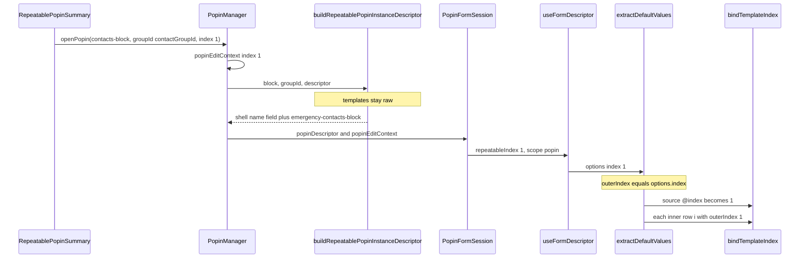
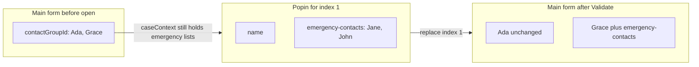
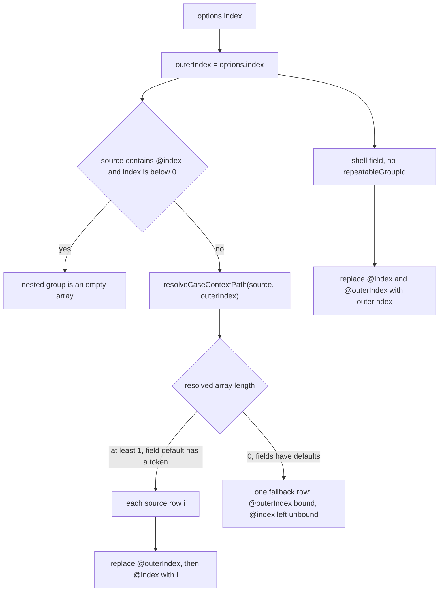

# Nested Repeatable Inside a Repeatable Popin

The demo Contacts block opens one contact at a time. Emergency contacts for that contact are a nested block, not fields copied onto Contacts.

The nested block keeps its own title, min, max, layout, and source. Its values are stored on the open contact row. How nesting works is in [nested-blocks.md](nested-blocks.md).

A same-block `repeatableGroupId` group is still used when the inner list is not its own block. The contact-info popin in `src/app/api/form/global-descriptor-demo/route.ts` keeps emergency contacts that way.

Source: `contacts-block` and `emergency-contacts-block` in that route. Prefill: `src/app/api/demo/prefill/route.ts`.

## Data flow

Opening Grace is index `1`. That number is stored once, on `popinEditContext`. The instance builder never receives it. Default extraction renames it `outerIndex`, then each template decides which token that number replaces.



`RepeatableFieldGroup` adds an inner row later. That call to `evaluateDefaultValue` passes no index, so both tokens stay in the template and the new row gets the field type default.



Create mode passes `index: -1`. A source that contains `@index` becomes `[]`, and Validate appends the popin object.

## Descriptor

```typescript
{
  id: 'contacts-block',
  title: 'Contacts',
  repeatable: true,
  repeatablePopin: true,
  repeatableSummaryTemplate: '{{#if name}}{{name}}{{else}}New contact{{/if}}',
  repeatableDefaultSource: 'contactGroupId',
  minInstances: 0,
  maxInstances: 5,
  nestedBlocks: [{ blockId: 'emergency-contacts-block', position: 'bottom' }],
  fields: [
    {
      id: 'contactGroupId.name',
      type: 'text',
      label: 'Contact Name',
      repeatableGroupId: 'contactGroupId',
      validation: [],
    },
  ],
}

{
  id: 'emergency-contacts-block',
  title: 'Emergency contacts',
  repeatable: true,
  minInstances: 1,
  maxInstances: 2,
  layout: { mode: 'grid', columns: 2 },
  repeatableDefaultSource: '{{json caseContext.contactGroupId.@index.emergencyContacts }}',
  fields: [
    {
      id: 'emergency-contacts.emergencyName',
      type: 'text',
      label: 'Emergency Contact Name',
      repeatableGroupId: 'emergency-contacts',
      validation: [],
      layout: { width: 'half' },
      defaultValue:
        '{{caseContext.contactGroupId.@outerIndex.emergencyContacts.@index.emergencyName}}',
    },
    {
      id: 'emergency-contacts.emergencyPhone',
      type: 'text',
      label: 'Emergency Contact Phone',
      repeatableGroupId: 'emergency-contacts',
      validation: [],
      layout: { width: 'half' },
      defaultValue:
        '{{caseContext.contactGroupId.@outerIndex.emergencyContacts.@index.emergencyPhone}}',
    },
  ],
}
```

| Piece | What it owns |
| --- | --- |
| `contacts-block` | The contact name, the summary, and min 0 / max 5 |
| `emergency-contacts-block` | The inner list, its title, min 1 / max 2, and a two-column layout |

`'emergency-contacts'` is the nested block's group id. It is the key written on the contact row. The case property `emergencyContacts` is a different string: it is the path the source reads.

## Case prefill

```typescript
contactGroupId: [
  {
    name: 'Ada',
    emergencyContacts: [{ emergencyName: 'Alice', emergencyPhone: '111' }],
  },
  {
    name: 'Grace',
    emergencyContacts: [
      { emergencyName: 'Jane', emergencyPhone: '098' },
      { emergencyName: 'John', emergencyPhone: '123' },
    ],
  },
]
```

A field `defaultValue` that contains `@index` or `@outerIndex` is evaluated per row. Fields without those tokens are copied from the row by base field id (`emergencyName`, `emergencyPhone`).

## What the main form does

Contacts renders as summaries. The nested block is not a second section, and its group is not a top-level form key. Main-form defaults store only the parent rows:

```typescript
contactGroupId: [
  { name: 'Ada' },
  { name: 'Grace' },
]
```

Emergency contacts stay on `caseContext` until that contact is opened.

## What opening a contact builds

`PopinManager` builds an instance descriptor. The shell is the opened contact. The nested block follows unchanged.

```typescript
{
  blocks: [
    {
      id: 'contacts-block-instance',
      title: 'Contacts',
      fields: [{ id: 'name', type: 'text', label: 'Contact Name', validation: [] }],
      nestedBlocks: [{ blockId: 'emergency-contacts-block', position: 'bottom' }],
    },
    // emergency-contacts-block, unchanged
  ],
}
```

The dialog title is Contacts. Inside the body, Emergency contacts shows once, with that block's add limit and layout. Opening Grace shows Jane and John. Opening Ada shows Alice.

## How `@index` is bound

`@index` in the nested block's `repeatableDefaultSource` is the open contact. For Grace that path is `caseContext.contactGroupId.1.emergencyContacts`. For Ada it is index `0`. The other contact's list is not loaded. `@outerIndex` is not an alias inside `repeatableDefaultSource`.



Grace, inner row `0`, rewrites the name default to `caseContext.contactGroupId.1.emergencyContacts.0.emergencyName` and reads Jane. Inner row `1` reads John.

The same path can be declared as a key, `caseContext.contactGroupId.@index.emergencyContacts`, or stringified with the `json` helper, `{{json caseContext.contactGroupId.@index.emergencyContacts}}`. The helper writes a JSON array string. Extraction uses that array when the source parses as one, and looks up a caseContext key otherwise.

`@index` inside an inner field `defaultValue` is the inner row. `@outerIndex` is the open popin row, so a template can remap a case-context key that is not the field id:

```typescript
defaultValue: '{{caseContext.contactGroupId.@outerIndex.emergencyContacts.@index.ecName}}'
```

Opening Grace (`index` 1) reads Jane from inner row 0 and John from inner row 1. The demo templates use `emergencyName` and `emergencyPhone`, the same keys as the prefill, so the seeded values stay Jane, John, and Alice.

An unbound `@outerIndex` (main scope, or create mode where the open index is `-1`) returns the field's type default, the same rule as an unbound `@index`. When the inner source array is empty, `@outerIndex` still binds and `@index` in that fallback stays unbound.

Create mode uses `index: -1`. A source that contains `@index` cannot be resolved, so the nested array starts as `[]`.

Add inside the popin does not receive the outer index. A remap template on that new row returns the type default, because `@index` is unbound there as well.

If this contact was already validated, the saved row is merged on top of those defaults. A later open keeps the emergency contacts the user edited.

## What Validate writes back

Validate replaces one element of `contactGroupId` with the popin value. The nested array is a property of that element.

After validating Grace:

```typescript
contactGroupId: [
  { name: 'Ada' },
  {
    name: 'Grace',
    'emergency-contacts': [
      { emergencyName: 'Jane', emergencyPhone: '098' },
      { emergencyName: 'John', emergencyPhone: '123' },
    ],
  },
]
```

Ada's row is unchanged until her popin is opened and validated. A new contact (`index` `< 0`) is appended.
